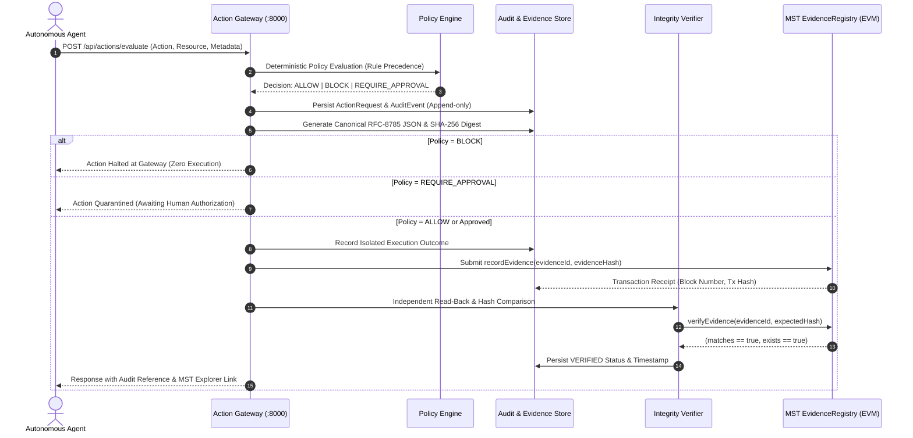

# SentinelMesh — Trust, Without Blind Faith

> **Enterprise Autonomous Agent Governance, Deterministic Policy Enforcement, Canonical Cryptographic Evidence & MST Blockchain Anchoring**

[](https://sentinelmesh-five.vercel.app)
[](https://github.com/shardul-2007/SentinelMesh)
[-10B981)](backend/tests)
[-10B981)](contracts/test)
[](https://testnet.mstscan.com)

---

## Quick Links for Hackathon Judges

| Resource | Link / Detail |
| :--- | :--- |
| **Live Web Console** | [https://sentinelmesh-five.vercel.app/](https://sentinelmesh-five.vercel.app/) |
| **Public GitHub Repository** | [https://github.com/shardul-2007/SentinelMesh](https://github.com/shardul-2007/SentinelMesh) |
| **MST Testnet EvidenceRegistry Contract** | [`0x0539fc70ee18fa936395c8dd6db623af6b43ceca`](https://testnet.mstscan.com/address/0x0539fc70ee18fa936395c8dd6db623af6b43ceca) |
| **Contract Deployment Tx Hash** | [`0x2623e2be8539fba8bb25d3e7ede4b70c53ccf54ee6beda30a2fa0b51988fdcc6`](https://testnet.mstscan.com/tx/0x2623e2be8539fba8bb25d3e7ede4b70c53ccf54ee6beda30a2fa0b51988fdcc6) |
| **Genuine Verified Evidence Tx Hash** | [`0xbb3072b6bd98f17f34f161d404cfdb9d557b56356ce1ddddc3a441907e9f8008`](https://testnet.mstscan.com/tx/0xbb3072b6bd98f17f34f161d404cfdb9d557b56356ce1ddddc3a441907e9f8008) |
| **7-Step Interactive Judging Demo** | Direct Access: [Action Simulator & Guided Tour](https://sentinelmesh-five.vercel.app/simulator) |

---

## 1. Hackathon Evaluation Criteria & How SentinelMesh Delivers

### A. Problem & Solution
* **The Problem:** Enterprise adoption of autonomous AI agents is blocked by security risks. AI agents possess real API keys and tool-calling power. Traditional prompt-level guardrails can be bypassed with adversarial jailbreaks. Standard database logs can be altered by compromised credentials or malicious administrators with zero cryptographic trace.
* **The Solution:** SentinelMesh introduces a zero-trust governance layer between AI agents and enterprise resources:
  1. **Deterministic Policy Gateway:** Intercepts agent actions before execution, enforcing rules deterministically (`ALLOW`, `BLOCK`, `REQUIRE_APPROVAL`).
  2. **Human-in-the-Loop Safeguards:** High-risk actions (financial transactions, data deletion) are quarantined until approved by an authorized Chief Security Officer (CSO).
  3. **Execution Containment Boundary:** All actions execute within an isolated sandbox, preventing arbitrary shell command execution or uncontrolled production mutations.
  4. **Cryptographic Proof Chain:** Every request, decision, and output is serialized via RFC-8785 canonical JSON and hashed with SHA-256 into an append-only cryptographic hash chain.

### B. Meaningful MST Blockchain Usage
* **Why Blockchain?** Databases can be tampered with by administrators. By anchoring cryptographic digests of evidence into the **MST Blockchain**, no single party can alter history without detection.
* **Smart Contract Architecture (`EvidenceRegistry.sol`):**
  * `recordEvidence(bytes32 evidenceId, bytes32 evidenceHash)`: Stores immutable 32-byte commitments with timestamp and submitter address.
  * `recordEvidenceWithPolicy(bytes32 evidenceId, bytes32 evidenceHash, bytes32 policyHash)`: Binds the evidence to an immutable policy version snapshot.
  * `recordEvidenceBatch(...)`: Batch-anchors up to 100+ events per EVM transaction for extreme gas and throughput efficiency.
  * `verifyEvidence(bytes32 evidenceId, bytes32 expectedHash)`: Allows independent on-chain readback and verification.
* **Off-Chain vs. On-Chain Design:**
  * **Off-Chain (Database / Local Store):** Large payloads, prompts, agent metadata, parameters, and execution outputs (preserves enterprise privacy and avoids excessive gas costs).
  * **On-Chain (MST Blockchain):** Strictly the canonical RFC-8785 SHA-256 digest (`bytes32`) and evidence ID.
* **Full On-Chain Read-Back Verification Cycle:**
  1. Agent submits action -> Policy Gateway evaluates -> Audit event generated.
  2. Canonical RFC-8785 JSON representation computed -> SHA-256 digest calculated.
  3. Gateway calls `EvidenceRegistry.recordEvidence()` on MST Testnet.
  4. Node waits for block receipt and confirms transaction.
  5. Gateway calls `verifyEvidence()` directly from the contract to read back the commitment.
  6. Contract verifies `onchain_hash == expected_hash` (`matches: true, exists: true`).
  7. Status updated to **`VERIFIED`**; any local modification immediately triggers a **`TAMPER_DETECTED`** alert.

### C. Working Product vs. Simulated Components
* **Real & Fully Implemented:**
  * Live deployed smart contracts on MST Testnet (`0x0539fc70ee18fa936395c8dd6db623af6b43ceca`).
  * Genuine confirmed transaction hashes on MST Testnet.
  * Full RFC-8785 deterministic JSON canonicalization and SHA-256 digest hashing.
  * 70 automated backend pytest tests covering all security invariants.
  * 27 Hardhat unit tests validating all contract branches and failure modes.
  * Live responsive Next.js frontend with 13 compiled static pages.
  * Real Role-Based Access Control (RBAC) with unique interfaces and capabilities for CSO/Admin, Security Analyst, and Viewer/Auditor.
  * BridgeKey wallet integration with 1-click network switching.
* **Transparently Sandboxed / Simulated:**
  * **Agent Execution Containment:** Evaluated agent actions execute in a controlled mock containment boundary rather than executing real `rm -rf` shell commands or executing actual monetary wire transfers on banking APIs, preserving host integrity during live evaluation.

### D. Verified MST Testnet Deployment Proof

| Parameter | Genuine On-Chain Value |
| :--- | :--- |
| **Network** | MST Testnet |
| **Chain ID** | `91562037` (`0x5752315`) |
| **RPC Endpoint** | `https://testnetrpc.mstblockchain.com` |
| **Explorer** | [https://testnet.mstscan.com](https://testnet.mstscan.com) |
| **Contract Address** | [`0x0539fc70ee18fa936395c8dd6db623af6b43ceca`](https://testnet.mstscan.com/address/0x0539fc70ee18fa936395c8dd6db623af6b43ceca) |
| **Deployment Tx Hash** | [`0x2623e2be8539fba8bb25d3e7ede4b70c53ccf54ee6beda30a2fa0b51988fdcc6`](https://testnet.mstscan.com/tx/0x2623e2be8539fba8bb25d3e7ede4b70c53ccf54ee6beda30a2fa0b51988fdcc6) |
| **Verified Evidence Tx Hash** | [`0xbb3072b6bd98f17f34f161d404cfdb9d557b56356ce1ddddc3a441907e9f8008`](https://testnet.mstscan.com/tx/0xbb3072b6bd98f17f34f161d404cfdb9d557b56356ce1ddddc3a441907e9f8008) |
| **Evidence ID** | `evt_eval_e2e_001` (also backward-compatible `evt_001_initial_compliance`) |
| **Evidence SHA-256 Digest** | `0x7b58c7d8122345598118dcf7760971b3e7bc8885b512e07198bb602c382f7678` |
| **Read-back Status** | **`VERIFIED`** (`verifyEvidence` returns `matches: true, exists: true`) |

### E. Scale & Enterprise Production Architecture
* **Multi-Agent Fleet Support:** Built for enterprise fleets running hundreds of concurrent autonomous agents (DevOps agents, financial bots, support assistants, data analyzers).
* **Batch Anchoring (`recordEvidenceBatch`):** Solves EVM gas limits and latency bottlenecks by aggregating multiple audit event digests into a single on-chain commit, drastically reducing costs while guaranteeing non-repudiation.
* **Multi-Tenant Isolation:** Cryptographically separates customer workspaces, preventing data crossover while providing global audit integrity.
* **Immutable Policy Versioning:** Smart contract stores `policyHash` alongside evidence, proving not just what the agent did, but the exact deterministic ruleset that governed it at the second of execution.

---

## 2. Interactive 7-Step Judging Walkthrough

Judges can test the entire lifecycle in 1 click using the **Auto-Run All 7 Steps** button on the [Action Simulator](https://sentinelmesh-five.vercel.app/simulator), or step through manually:

1. **Step 1: Permitted Agent Action (`ALLOW`):**
   * Action: `agent-customer-bot` requesting read access to `db://crm/contacts`.
   * Result: Policy `POL-B` evaluates deterministically to `ALLOW`. Action proceeds safely.
2. **Step 2: Prohibited Action Blocked (`BLOCK`):**
   * Action: `agent-untrusted` attempting `EXECUTE` on `os://host/bin/bash`.
   * Result: Policy `POL-A` blocks the action at the gateway. Zero shell execution occurs.
3. **Step 3: High-Risk Action Requiring Human Sign-Off (`REQUIRE_APPROVAL`):**
   * Action: `agent-financial-bot` attempting `DELETE` on financial records.
   * Result: Policy `POL-D` halts execution, queues request for CSO approval, and executes only after authorized sign-off.
4. **Step 4: Canonical RFC-8785 SHA-256 Evidence Generation:**
   * Audit event is serialized with sorted keys, deterministic float formatting, and zero whitespace.
   * Generates a 32-byte digest linked to previous event hashes in an append-only chain.
5. **Step 5: MST Testnet Smart Contract Anchoring:**
   * Gateway calls `recordEvidence()` on `EvidenceRegistry.sol` (`0x0539fc70ee18fa936395c8dd6db623af6b43ceca`).
   * Receives confirmation and transaction hash on MST Testnet (Chain ID `91562037`).
6. **Step 6: Public MST Explorer Verification:**
   * Links directly to `https://testnet.mstscan.com/tx/0xbb3072b6bd98f17f34f161d404cfdb9d557b56356ce1ddddc3a441907e9f8008` for public verification.
7. **Step 7: Independent On-Chain Read-Back & Tamper Detection:**
   * Gateway executes `verifyEvidence()` against the deployed contract.
   * Compares on-chain commitment with locally recalculated hash, confirming cryptographic integrity.

---

## 3. End-to-End Workflow Architecture



---

## 4. Repository Structure

```
SentinelMesh/
├── backend/                        # FastAPI Core API & Security Engine
│   ├── app/
│   │   ├── api/                    # REST API routers
│   │   │   ├── actions.py          # Action evaluation & gateway containment
│   │   │   ├── integrity.py        # Canonical hashing, anchoring & evidence inspector
│   │   │   ├── policies.py         # Deterministic policy catalog (POL-A..G)
│   │   │   ├── approvals.py        # Human-in-the-loop review & authorization
│   │   │   ├── threats.py          # Behavioral threat detection & lab scenarios
│   │   │   └── governance.py       # End-to-end evidence provenance
│   │   ├── blockchain/             # MST Blockchain Web3 integration
│   │   │   ├── service.py          # RPC provider, contract calls & tx signer
│   │   │   └── EvidenceRegistry.json # Contract ABI & bytecode metadata
│   │   ├── integrity/              # Canonicalization & verification engine
│   │   │   ├── canonical.py        # RFC-8785 deterministic JSON & SHA-256
│   │   │   └── verifier.py         # Independent local & on-chain verification
│   │   ├── policy_engine/          # Deterministic rule evaluator
│   │   └── database.py             # SQLAlchemy ORM (SQLite / PostgreSQL)
│   └── tests/                      # 70 automated pytest test cases
├── contracts/                      # Hardhat EVM Smart Contracts
│   ├── contracts/
│   │   ├── EvidenceRegistry.sol    # Primary MST Evidence Registry contract
│   │   └── SentinelMeshAuditAnchor.sol # Backward-compatible audit anchor
│   ├── scripts/
│   │   └── deploy.js               # Network deployment script for MST Testnet/Mainnet
│   ├── test/                       # 27 comprehensive Hardhat unit tests
│   └── hardhat.config.js           # Multi-network EVM config (MST Testnet 91562037)
├── frontend/                       # Next.js 14 Security Console (App Router)
│   ├── src/
│   │   ├── app/
│   │   │   ├── page.tsx            # Security Operations Overview & Judge Callout
│   │   │   ├── simulator/page.tsx  # Action Gateway & Interactive Judge Tour
│   │   │   ├── policies/page.tsx   # Policy Studio
│   │   │   ├── approvals/page.tsx  # Approval Queue
│   │   │   ├── audit/page.tsx      # Audit Explorer
│   │   │   ├── integrity/page.tsx  # Integrity Center & Tamper Alerts
│   │   │   ├── blockchain/page.tsx # Blockchain Activity & Evidence Inspector
│   │   │   ├── threats/page.tsx    # Threat Intelligence Center
│   │   │   ├── governance/page.tsx # Autonomous Governance & Provenance
│   │   │   └── settings/page.tsx   # Settings & Node Diagnostics
│   │   ├── components/             # Reusable UI primitives (JudgeDemoTour, AppShell, Header)
│   │   └── lib/                    # API client, RBAC system & TypeScript interfaces
│   └── tailwind.config.js          # High-End Cyber Console design tokens
└── README.md                       # Product documentation & evaluation guide
```

---

## 5. Visual Language & Warm Enterprise Palette

Built strictly with the user-specified **Warm Enterprise Palette**:

- **Carbon Canvas (`#111317` / `#1A1D24`):** Professional high-contrast obsidian slate surfaces.
- **Amazon Gold (`#FF9900`):** Primary branding, active borders, and evaluation highlights.
- **Flipkart Sunrise Orange (`#FB641B`):** Secondary interactive accents, buttons, and high-visibility CTAs.
- **Emerald Green (`#10B981`):** Verified on-chain evidence (`INTACT`), approved policies (`ALLOW`), operational nodes.
- **Crimson Red (`#EF4444`):** Blocked unauthorized operations (`BLOCK`), cryptographic tamper mismatch alerts.
- **Typography:** Pure white text (`#F8FAFC`) with muted slate metadata (`#94A3B8`) and monospaced cryptographic digests (`font-mono`).

---

## 6. Installation & Local Development

### Prerequisites

- **Python:** 3.10+ (tested on Python 3.12 / 3.14)
- **Node.js:** v18+ (tested on Node.js v24)
- **Hardhat:** v2.22+

### Step 1: Clone & Setup

```bash
git clone https://github.com/shardul-2007/SentinelMesh.git
cd SentinelMesh
```

### Step 2: Backend Setup & Testing

```powershell
# 1. Activate virtual environment
.\venv\Scripts\Activate.ps1

# 2. Run automated backend test suite (70 passing tests)
.\venv\Scripts\python.exe -m pytest backend/tests

# 3. Start the FastAPI backend
python -m uvicorn app.main:app --app-dir backend --host 127.0.0.1 --port 8000 --reload
```

*Interactive Swagger API Docs:* `http://127.0.0.1:8000/docs`

### Step 3: Smart Contract Compilation & Testing

```bash
cd contracts
npm install

# Run 27 Hardhat unit tests
npx hardhat test

# Deploy to MST Testnet (requires funded signer key in .env)
npx hardhat run scripts/deploy.js --network mstTestnet
```

### Step 4: Frontend Development Server

```bash
cd frontend
npm install

# Run TypeScript type check
npx tsc --noEmit

# Start development server
npm run dev
```

*Console URL:* `http://localhost:3000`

---

## 7. Automated Test Verification Results

### 1. Smart Contract Test Suite (27/27 Passing)
```
  EvidenceRegistry Contract
    Deployment & Access Control
      ✔ should set deployer as owner and initial authorized submitter
      ✔ should allow owner to revoke or grant submitter role
      ✔ should reject non-owner attempting to grant submitter role
    Evidence Recording
      ✔ should allow authorized submitter to record evidence and emit events
      ✔ should allow recording evidence with policy commitment
      ✔ should reject duplicate evidence ID recording
      ✔ should reject unauthorized callers from recording
      ✔ should reject empty evidence ID or empty hash
      ✔ should support batch recording with length matching
    Evidence Verification
      ✔ should verify matching on-chain evidence correctly
      ✔ should detect hash mismatch for tampered hash
      ✔ should return false for unrecorded evidence ID
      ✔ should support backward-compatible verifyAnchor and getAnchor calls

  SentinelMeshAuditAnchor Contract
    Deployment & Access Control
      ✔ should set deployer as owner and initial authorized anchorer
      ✔ should allow owner to revoke or grant anchorer role
      ✔ should reject non-owner attempting to grant anchorer role
    Audit Hash Anchoring
      ✔ should allow owner to anchor an event hash and emit EventAnchored
      ✔ should allow authorized signer to anchor an event hash
      ✔ should reject unauthorized caller attempting to anchor
      ✔ should reject duplicate anchor for the same event ID (Immutable)
      ✔ should reject empty event ID or zero hash
    Public Verification
      ✔ should return (true, true) when verifying the exact anchored hash
      ✔ should return (false, true) when verifying an altered hash (Tamper Detection)
      ✔ should return (false, false) for non-existent event ID
      ✔ should revert getAnchor for non-existent event ID
    Batch Anchoring
      ✔ should anchor multiple events in a single transaction
      ✔ should revert if array lengths mismatch

  27 passing (1s)
```

### 2. Backend Integration Test Suite (70/70 Passing)
```
backend/tests/test_api.py ......                                         [  8%]
backend/tests/test_approvals.py .                                        [ 10%]
backend/tests/test_auth_and_reports.py .....                             [ 17%]
backend/tests/test_canonical_hashing.py .......                          [ 27%]
backend/tests/test_end_to_end_flow.py ..                                 [ 30%]
backend/tests/test_governance_provenance.py ......                       [ 38%]
backend/tests/test_integrity_api.py .....                                [ 45%]
backend/tests/test_integrity_verification.py ....                        [ 51%]
backend/tests/test_multi_agent_incidents.py .......                      [ 61%]
backend/tests/test_policy_engine.py ...........                          [ 77%]
backend/tests/test_rbac_matrix.py .....                                  [ 84%]
backend/tests/test_threat_detection.py ...........                       [100%]

====================== 70 passed in 7.07s ======================
```

### 3. Frontend Production Build (13/13 Routes Compiled)
```
Route (app)                              Size     First Load JS
┌ ○ /                                    10.2 kB         131 kB
├ ○ /_not-found                          873 B          88.1 kB
├ ○ /approvals                           6.82 kB         113 kB
├ ○ /audit                               7.59 kB         114 kB
├ ○ /blockchain                          9.94 kB         113 kB
├ ○ /governance                          6.87 kB         110 kB
├ ○ /integrity                           8.48 kB         115 kB
├ ○ /policies                            6.52 kB         110 kB
├ ○ /settings                            6.42 kB         110 kB
├ ○ /simulator                           10.9 kB         128 kB
└ ○ /threats                             9.99 kB         113 kB
+ First Load JS shared by all            87.3 kB
```

---

## 8. Security Boundaries & Operational Invariants

1. **Client Risk Inputs Discarded:** Client-provided risk ratings are untrusted. The backend policy engine derives risk from resource classification and operation type.
2. **Append-Only Evidence:** Neither the REST API nor the database schema expose delete or update methods for `AuditEvent` or `IntegrityRecord`.
3. **Execution Containment:** High-risk or approved actions run in an isolated execution environment; destructive host OS commands or uncontrolled network calls are strictly prevented.
4. **Offline Resilience:** If the blockchain node or network is unreachable, SentinelMesh continues operating in local verified mode and clearly reports node status as disconnected without generating fake transaction hashes.
5. **Secret Redaction:** Backend transaction submission redacts private keys from all logs, exception strings, and API responses.

---

## 9. License

Distributed under the MIT License. Copyright (c) 2026 SentinelMesh Team.
